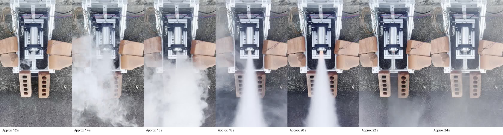

# October 13 TMS data review

The supplied files contain **one clear thrust event (TMS_4), two no-event recordings (TMS_2/TMS_5), and two startup probes (TMS_1/TMS_3)**. Pressure is unusable in every file. Thrust magnitude is broadly consistent with April/May, but the October recording does not establish validated motor performance.

## Inventory and provenance

The user confirmed the calendar date as 2026-10-13. The filenames are SD recording numbers, not global test numbers. Original bytes, including CRLF line endings, are retained; hashes and exact source names are in [the session manifest](./2026-10-13_session_manifest.json).

| Original file | Classification | Sensor pairs | Nominal coverage at 320 Hz | Pressure ADC |
|---|---|---:|---:|---|
| TMS_1.TXT | Startup probe | 1 | — | 32767 throughout |
| TMS_2.TXT | No sustained thrust event | 4705 | 14.703125 s | 32767 throughout |
| TMS_3.TXT | Startup probe | 1 | — | 32767 throughout |
| TMS_4.TXT | Clear thrust event (provisional) | 4505 | 14.078125 s | 32767 throughout |
| TMS_5.TXT | No sustained thrust event | 4444 | 13.887500 s | 32767 throughout |

The two header values in timed recordings are microsecond uptime values, not calendar dates. TMS_4 and TMS_5 share power-on value 525348 and start about 15.58824 seconds apart. TMS_2 has a different power-on value. This supports separate recordings; it does not label the reason for each trigger.

## Thrust and historical comparison

| Date | Peak (N) | Impulse (N s) | Burn (ms) | Filtered 10–90% rise (ms) | Final second mean (N) | Peak pressure (bar) |
|---|---:|---:|---:|---:|---:|---:|
| 2026-04-03 | 174.42 | 368.74 | 3287.5 | 734.4 | -1.238 | 39.241 |
| 2026-04-08 | 203.00 | 387.07 | 2687.5 | 596.9 | 2.075 | 44.304 |
| 2026-05-28 | 174.19 | 366.33 | 2818.7 | 621.9 | 0.572 | 42.496 |
| 2026-07-16 | 323.79 | 484.66 | 2331.2 | 193.7 | 1.788 | 38.018 (suspect) |
| 2026-10-13 | 166.01 (provisional) | 370.22 (provisional) | Unvalidated | 346.9 | 4.961 | Unavailable |

October's 166.01 N peak is 4.8% below April 3, 18.2% below April 8, 4.7% below May 28, and 48.7% below July 16. Its reported 370.22 N s is within 1.1% of April 3 and May 28, but **this impulse is provisional**. July is a higher-thrust recording and its pressure channel already has documented anomalies; it is not a clean pressure reference.

The October loadcell is not ADC-clipped (raw range −5340 to −4880). Initial 0.5-second raw force noise is 1.007 N standard deviation. The force peak is clear relative to that noise and its polarity agrees with the existing calibration. No same-day calibration, uncertainty budget, propellant mass, motor geometry, or independent thrust reference was supplied. The previous calibration's R² does not certify this test.

**Post-event offset:** the final second remains at 4.961 ± 0.157 N (mean ± standard deviation), almost equal to the 4.980 N event threshold. This is about 12.94 ADC counts of baseline change. The legacy first/last crossing algorithm reports onset 7.321875 s and end 14.075000 s, exactly the last sample. Its 6.753125 s “burn” and 54.82 N average are therefore not reliable burn metrics and are withheld from the catalog. The full trace is published so the tail remains visible.

As a sensitivity check only, interpolating between the pre-event and final baselines gives 165.06 N peak, 348.22 N s, and 3.421875 s duration. This changes impulse by about 5.9%. **These are not replacement performance values:** neither the time course nor the cause of the baseline change is known.

## Pressure diagnosis

Every pressure value is 32767 in all five files, including the startup probes: 13,654 timed samples plus two setup samples. This is positive full-scale code 0x7FFF for the ADS1115 ([TI datasheet, data format](https://www.ti.com/lit/gpn/ads1115)). The repository firmware configures the pressure ADC at address 0x49, single-ended AIN0, GAIN_ONE. The exact cause cannot be isolated from these logs: overrange input, sensor/wiring/power/reference problems, or a stuck ADC/read path require bench checks.

Applying the old pressure conversion gives 88.3609 bar at every sample. Subtracting that constant baseline would then produce an apparently flat zero-bar trace. **Neither number is a pressure measurement.** The corrected pipeline checks raw ADC first and exports `nan` in pressure TSV columns and `null` in JSON; the website shows unavailable and excludes October from pressure comparisons.

Before a further pressure interpretation, verify the selected input, sensor output voltage and ground reference, gain/range, wiring, and ADC communication against a known pressure reference. These logs cannot establish chamber pressure or a thrust/pressure relationship.

## Processing and timing limits

The main script is `TMS/Calibration/tms_data_pipeline.py`, code commit `7c717b7dfc8bdc745e766173d23c5b90ebf4827e`. The latest pushed main was fetched and the script matched it before this final run; SHA-256 is `a30adb6112b96a7bb676983715853745afde0d7d930035912a50a3f5e111d4d5`. The experimental temperature/drift script was not used. Settings match previous processing: inherited −0.0391 kg/ADC slope, −193.0049 kg intercept, 9.80665 m/s², horizontal baseline, 20 Hz/order 2 zero-phase force filter, and a 3% event threshold. The loader is corrected to remove two header lines **before** channel splitting, retaining the first sensor pair. Historical published outputs are retained, with the legacy 3.125 ms origin omission documented. Raw April 3 data was available locally. The local checkout was behind GitHub; April 8/May 28/July 16 originals were recovered from TMS main commit `abb02a0` and are now published beside each historical record. The legacy pipeline reproduces their entire published filtered thrust and pressure series to within 0.000001 in their respective units. Historical calibration coefficients agree with the current main pipeline.

The firmware targets a 15-second loop, but these three recordings contain only 14.703125, 14.078125, and 13.887500 seconds of samples at nominal 320 Hz. Per-sample timestamps are absent, so SD/I2C timing overhead or truncation cannot be resolved and no rescaling to 15 seconds is justified. The time axis, rise times, and impulse assume 320 Hz. “Ignition delay” is time from recording start, not independently verified command-to-ignition latency.

No-event logs use the first 0.5 seconds as baseline and receive no firing metrics. A conservative gate requires force above `max(5 N, 10 × initial raw standard deviation)` for 0.1 seconds; this prevents idle noise from becoming a false full-record burn.

## Supplied video

The user supplied a 26.08-second portrait video for this session. The original is retained alongside an H.264/AAC SDR copy for browser playback. The frame strip shows a visible discharge/plume starting around 12–14 seconds, a more concentrated jet later, and a residual plume afterward. These approximate visual observations do not establish thrust, pressure, or combustion duration. There is no shared trigger/timestamp for synchronization with the logger. The available frames do not establish whether small stand motion caused the 5 N offset.

[Browser video](../video/2026-10-13_tms-4_video.mp4) · [Original video](../video/2026-10-13_tms-4_video_original.mp4)

## Assessment

Thrust: a clear event with plausible magnitude relative to April/May, suitable for a **provisional comparison**. Resolve the zero shift, calibration and timing before treating impulse or burn duration as validated performance. Pressure: **invalid**, and not aligned with the previously usable April/May pressure records. Video cannot recover the missing pressure channel.
