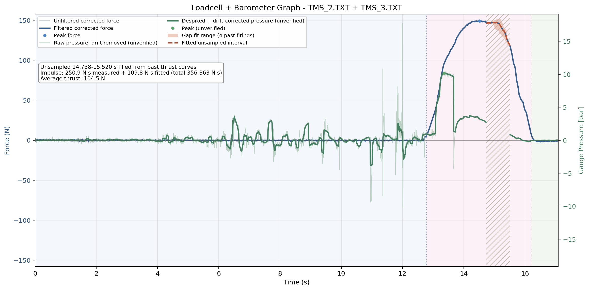

# 2026-11-23 TMS session

One firing split across two recordings. The ignition delay was long enough that the burn crossed the logger's fixed 15-second file boundary: `TMS_2.TXT` holds the ignition, rise and plateau and ends under load; `TMS_3.TXT` starts under load and holds the decay to baseline. The 0.782 s between the files was not recorded and is filled by fitting earlier firings' thrust curves.

| Result | Value |
|---|---:|
| Peak thrust (measured) | 149.17 N at 14.512 s |
| Total impulse (estimated) | 361.18 N s (range 356.88–363.55) |
| — measured part | 250.92 N s (`TMS_2` 210.70 + `TMS_3` 40.22) |
| — fitted unsampled interval | 110.26 N s (range 105.96–112.63) |
| Average thrust (estimated) | 104.66 N |
| Burn duration (5 N, header-aligned) | 3450.8 ms (12.772 → 16.223 s) |
| Time to onset from `TMS_2` start | 12771.9 ms |
| Chamber pressure | Suspect: drift-corrected peak 10.17 bar at 13.353 s does not track thrust |

Times are from the start of `TMS_2` at a nominal 320 Hz. Measured impulse alone (250.92 N s) is a strict lower bound.



| Record | Files |
|---|---|
| Whole firing (`TMS_2` + `TMS_3`) | [Report](./analysis/2026-11-23_tms-2-3_executive_report.txt) · [Loadcell](./analysis/2026-11-23_tms-2-3_loadcell_plot.png) · [Pressure](./analysis/2026-11-23_tms-2-3_barometer_plot.png) · [Combined](./analysis/2026-11-23_tms-2-3_combined_plot.png) · [TSV](./analysis/2026-11-23_tms-2-3_pipeline_data.txt) · [Fit and metrics](./analysis/2026-11-23_tms-2-3_joint.json) |
| `TMS_2.TXT` alone | [Raw](./TMS_2.TXT) · [Report](./analysis/2026-11-23_tms-2_executive_report.txt) · [TSV](./analysis/2026-11-23_tms-2_pipeline_data.txt) · [Quality](./analysis/2026-11-23_tms-2_quality.json) · [Combined](./analysis/2026-11-23_tms-2_combined_plot.png) · [Loadcell](./analysis/2026-11-23_tms-2_loadcell_plot.png) · [Pressure](./analysis/2026-11-23_tms-2_barometer_plot.png) |
| `TMS_3.TXT` alone | [Raw](./TMS_3.TXT) · [Report](./analysis/2026-11-23_tms-3_executive_report.txt) · [TSV](./analysis/2026-11-23_tms-3_pipeline_data.txt) · [Quality](./analysis/2026-11-23_tms-3_quality.json) · [Combined](./analysis/2026-11-23_tms-3_combined_plot.png) · [Loadcell](./analysis/2026-11-23_tms-3_loadcell_plot.png) · [Pressure](./analysis/2026-11-23_tms-3_barometer_plot.png) |

[Session manifest](./analysis/2026-11-23_session_manifest.json) records input, code and output hashes.

## Processing for this session

This session differs from earlier ones in three ways: the firing spans two files, the gap between them is estimated, and the pressure channel is drift-corrected. Everything else follows the standard pipeline.

1. **Per-file pipeline.** Each file was run through `tms_data_pipeline.py` with the fixed 5 N threshold. `TMS_2` is flagged provisional because it ends above threshold. `TMS_3` reports no event because its own first 0.5 s, used as baseline, is already under load. These per-file outputs are kept for traceability; the whole-firing record below supersedes their thrust metrics.
2. **Alignment.** Both files share power-on uptime 472444 µs. `TMS_3` is placed 15.519536 s after `TMS_2` from the difference of their sampling-start headers. With 4,717 pairs per file at 320 Hz, `TMS_2` ends at 14.738 s, leaving 14.738–15.520 s unsampled.
3. **Baseline and filtering.** The `TMS_2` pre-event offset (-60.10 N, mean of raw force up to 6.39 s) is subtracted from both files. `TMS_3` settles to -0.56 ± 0.18 N, which confirms the shared baseline. Each file is low-passed separately (Butterworth 20 Hz, order 2); nothing is filtered across the gap.
4. **Gap edges.** Edge level and slope come from a quadratic fit to the unfiltered force over the 0.25 s next to each edge: 147.83 N and -11.6 N/s at the end of `TMS_2`, 116.44 N and -144.4 N/s at the start of `TMS_3`. The last filtered sample of `TMS_2` (146.30 N) is not used: the zero-phase filter's end behaviour pulls it toward the final few raw values, about 2 N below the ~148.6 N plateau.
5. **Gap fill from earlier firings.** Peak-normalized filtered thrust from earlier TMS sessions is fitted, with amplitude, time shift and time stretch free, to the last 1 s of `TMS_2` and the measured decay in `TMS_3`. Each fill is pinned to the two edge levels. Fits with RMS error ≤ 6 N are accepted:

   | Template | RMS error | Gap impulse | Used |
   |---|---:|---:|:---:|
   | 2026-04-03 | 5.63 N | 110.3 N s | yes |
   | 2026-04-08 | 3.48 N | 112.6 N s | yes |
   | 2026-05-28 | 5.63 N | 110.6 N s | yes |
   | 2026-10-13 (`TMS_4`) | 5.70 N | 106.0 N s | yes |
   | 2026-07-16 | 9.74 N | 107.7 N s | no: no plateau |
   | 2026-07-23 (`TMS_7`) | 6.96 N | 108.3 N s | no: fit at parameter limit |
   | 2026-07-24 (`TMS_5`) | 16.85 N | 105.3 N s | no: fit at parameter limit |

   The median accepted fill gives 110.26 N s; the accepted spread gives 105.96–112.63 N s. As cross-checks, a knee fit that continues the `TMS_2` end trend into the back-projected `TMS_3` decay gives 110.07 N s, and a straight line gives 103.34 N s. The fill continues the plateau at about 148 N for roughly 0.35 s, then turns into the measured decay.
6. **Event window.** Onset is the first 5 N crossing in `TMS_2`, and burn end is the last 5 N crossing in `TMS_3` on the header-aligned axis. Impulse integrates the measured force plus the fitted gap over that window; average thrust is impulse divided by duration.
7. **Pressure.** The sensor is in the chamber, so the offset step at 6.4 s (from ~300 to ~4,500 ADC counts, with no thrust) and the ~19 bar level after burnout are treated as sensor drift. A 0.1 s running median removes spikes. A PCHIP baseline through 0.5 s medians of all thrust-free periods (before 12.67 s and after 16.52 s) is then subtracted. The residual outside the burn is 0.53 bar RMS. Inside the burn, the corrected signal holds a flat ~10 bar block from 13.1 to 13.7 s while thrust is still rising (95 N at the pressure peak). It then drops to 2–4 bar while thrust reaches its 149 N plateau, and correlates with thrust at only r = 0.34. Chamber pressure cannot fall while thrust rises, so the channel is published as suspect and is not used for any performance value.

`filtered_force_N` in the whole-firing TSV is measured data only and is `nan` in the gap. `analysis_force_N` adds the fitted gap, with `gap_fit_low_N` and `gap_fit_high_N` giving the template range. Raw ADC columns are carried unchanged. `filtered_gauge_pressure` is the despiked, drift-corrected pressure, and `pressure_drift_baseline_bar` is the subtracted baseline.

### Limits

- The logger records no per-sample timestamps. If the real rate is below 320 Hz, each file covers more time, the gap is shorter, and the fitted share of the impulse shrinks.
- The fitted interval assumes this motor follows the plateau-then-decay shape of earlier firings. It cannot reveal events confined to the gap.
- The command-to-ignition delay was not logged; the 12.77 s onset is measured from the start of the recording.
- Calibration is inherited from the existing pipeline; no same-day calibration was supplied.

## Reproduce

Pipeline commit `0604925` (fixed 5 N threshold); joint analysis `Calibration/tms_split_recording.py` at commit `efd13eb`.

```sh
python Calibration/tms_data_pipeline.py --input Data/2026/11_23/TMS_2.TXT --prefix 2026-11-23_tms-2 --no-show --dpi 180
python Calibration/tms_data_pipeline.py --input Data/2026/11_23/TMS_3.TXT --prefix 2026-11-23_tms-3 --no-show --dpi 180
python Calibration/tms_split_recording.py Data/2026/11_23/TMS_2.TXT Data/2026/11_23/TMS_3.TXT --prefix 2026-11-23_tms-2-3 --templates "Data/2026/4_2/analysis/26.04.03 data_pipeline_data.txt" "Data/2026/4_8/analysis/2026.04.08 data_pipeline_data.txt" "Data/2026/5_28/analysis/2026.05.28 data_pipeline_data.txt" "Data/2026/7_16/analysis/2026.07.16 data_pipeline_data.txt" Data/2026/7_23/analysis/2026-07-23_tms-7_pipeline_data.txt Data/2026/7_24/analysis/2026-07-24_tms-5_pipeline_data.txt Data/2026/10_13/analysis/2026-10-13_tms-4_pipeline_data.txt
```
